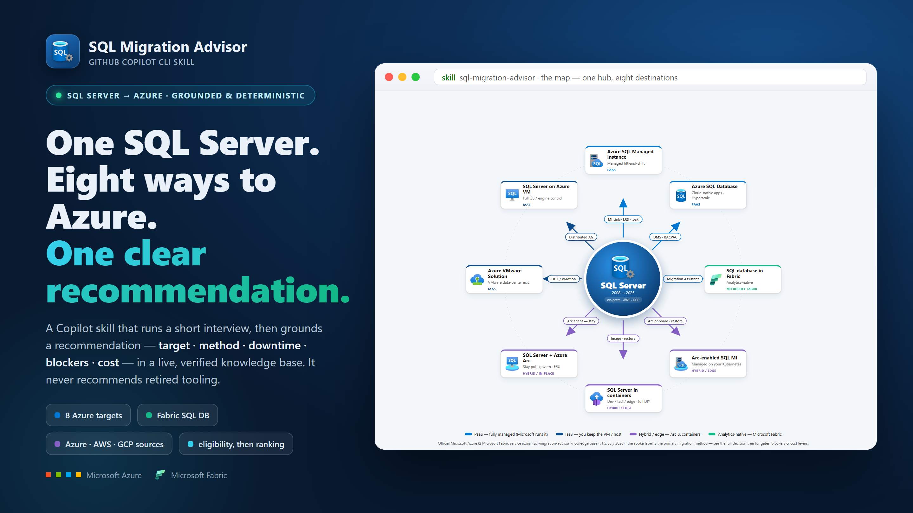
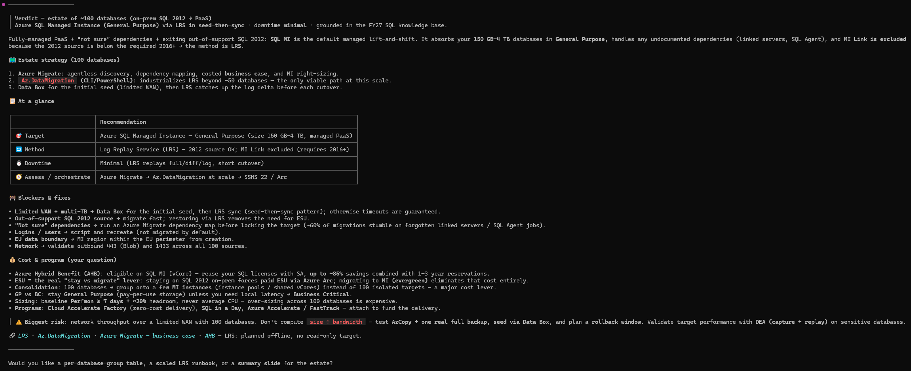
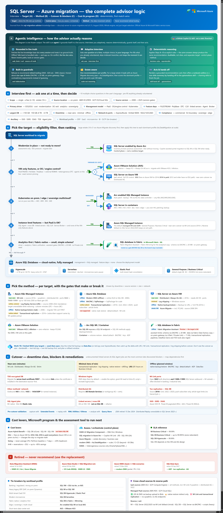
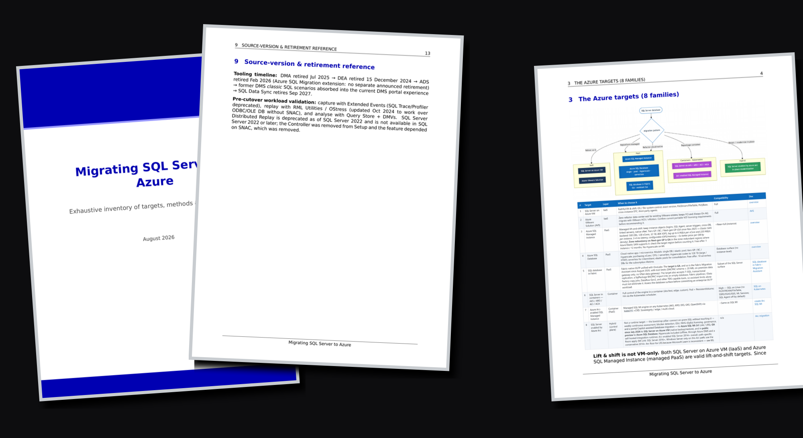

<h1 align="center">sql-migration-advisor</h1>

<p align="center">
  A <a href="https://docs.github.com/copilot/how-tos/use-copilot-agents/use-copilot-cli">GitHub Copilot CLI</a>
  skill that produces a preliminary, evidence-backed SQL Server → Azure migration recommendation —
  and the verified knowledge base behind it.
</p>

<p align="center">
  
  
  
  <a href="https://github.com/fredgis/sql-migration-advisor/actions/workflows/weekly-kb-check.yml"></a>
  <a href="https://github.com/fredgis/sql-migration-advisor/actions/workflows/tests.yml"></a>
</p>

<p align="center">
  <a href="https://fredgis.github.io/sql-migration-advisor/"><b>📖 Docs — how the skill works &amp; stays up to date →</b></a>
  &nbsp;·&nbsp;
  <a href="https://fredgis.github.io/sql-migration-advisor/rule-graph.html"><b>🕸️ Explore the rules →</b></a>
</p>

<p align="center">
  
</p>

### 🎬 See it in action

A short screen recording of the skill at work: you ask in plain language, answer the guided interview, and it returns a preliminary assessment path (target, method, downtime, blockers, confidence, and cost levers), grounded in the bundled knowledge base.

<video src="https://github.com/user-attachments/assets/5594fc75-4fb7-40a9-b9a1-0cc761c8aebe" poster="https://github.com/fredgis/sql-migration-advisor/raw/main/images/sql-migration-advisor-demo-poster.jpg" controls muted></video>

---

Ask Copilot *"migrate a SQL Server environment to Azure"* (or *"migrer SQL Server vers Azure"*).
The skill runs a short, structured interview, then returns a grounded, regression-tested
preliminary recommendation for assessment and validation:

- **Primary path** — target and method to assess first: SQL VM · AVS · SQL MI · SQL DB · Fabric SQL DB · Arc SQL MI · container · Arc in-place
- **Best alternative** — the strongest fallback path when trade-offs or unknowns remain
- **Exclusions** — why other targets were ruled out, including hard blockers and remediation options
- **Confidence** — status, assumptions, unknowns, and evidence required ([what the levels mean](#how-it-works))
- **Downtime class** — near-zero · minimal · offline
- **Cost levers** — Azure Hybrid Benefit · ESU; not a sizing or pricing estimate

It never recommends retired tooling (DMA, the Azure Data Studio extension, DMS *classic*).

<video src="https://github.com/user-attachments/assets/c6108b23-af0b-45d6-9dd8-feb5bad9d679" controls muted></video>



Every recommendation is grounded in the knowledge base
[`docs/sql-server-to-azure-migration.md`](docs/sql-server-to-azure-migration.md). It ships at the
same commit as the rules, so a recommendation can be reproduced by fetching that commit, and the
skill reads nothing over the network. The result is a preliminary disposition, not a final migration
verdict: tool-based assessment and architect validation are mandatory before execution. Every answer
opens by stating which knowledge-base version loaded, so the advice is traceable.

## Why it is trustworthy

- **Verified knowledge** — the knowledge base is source-backed and corrected against Microsoft Learn.
- **Rules under regression test** — Phase A filters hard eligibility, then Phase B ranks viable options and tiers. An executable mirror in `tests/` replays 118 scenarios through those rules on every commit. The mirror is not what runs in your session: an agent reads the rules and applies them, so this is a tested policy rather than a byte-identical guarantee.
- **Every decision is addressable** — the card cites a rule ID for each verdict, and [`reference/decision-rules.md`](reference/decision-rules.md) ends with an index of all 31. Look one up, read what it consumes and how it treats an unknown, and argue with it.
- **You see what lost, not just what won** — the card lists every method the knowledge base supports for the chosen target, each with a status and a reason. A method that is never enumerated is never rejected either, so its absence cannot be argued with; that is how Azure DMS stayed out of the Managed Instance guidance while the matrix declared it supported. Any candidate marked `available` can be handed to the prerequisite companion instead of the recommended one.
- **Explicit uncertainty** — every recommendation is `provisional`, and `medium` is the confidence ceiling. Nothing higher is reachable from an interview, because the skill reads no artefact from your estate. It carries assumptions, unknowns, blockers and the evidence a tool would have to produce.
- **It checks its own answer** — before the card is shown, the skill re-reads its draft against the 16 invariants in [`reference/output-contract.md`](reference/output-contract.md). One of them: no eligibility claim may rest on a field you never answered. A failed invariant is shown to you, never silently repaired.
- **Freshness gates** — version bumps require substantive diffs; link checks classify bot-blocked pages; high-risk claims are tracked in [`reference/claims-registry.json`](reference/claims-registry.json).
- **Regression protection** — [`tests/`](tests/) holds 118 golden scenarios and 76 gates wired into CI, plus a branch-coverage floor on the decision engine so a gate cannot exist over code no scenario reaches.

## One version, every surface

The release tag is quoted by three manifests, a PDF, a poster, this README and a published rule graph. The skills Microsoft publishes, and their knowledge bases, carry no version: Microsoft releases the package, and this repository releases by tag. `check-artifacts` compares every version below against the release manifest, fails when one drifts, and rewrites them under `--fix-prose`.

<!-- surfaces:start -->

| Surface | Version | Up to date |
| --- | --- | --- |
| `version.json`, `plugin.json`, `marketplace.json` | `v4.0.0` | ✅ |
| [PDF](docs/sql-server-to-azure-migration.pdf) and its preview image | `v4.0.0` | ✅ |
| Poster caption and PNG | `v4.0.0` | ✅ |
| This README's badge and PDF sentence | `v4.0.0` | ✅ |
| **This table** | `v4.0.0` | ✅ |
| [Published rule graph](https://fredgis.github.io/sql-migration-advisor/rule-graph.html) | `v4.0.0` | ✅ |
| Both published skills, their knowledge bases, rules, contracts and schemas | no version | ✅ |
| [Official package](https://github.com/microsoft/microsoft-sql/tree/main/plugins/microsoft-sql-migration): both skills, byte for byte | — | ✅ |
| [Microsoft fork](https://github.com/microsoft/sql-migration-agent) | — | ✅ |
| The six `blume/public/*.svg` mirrors | — | ✅ |
| [`blume/docs/index.mdx`](blume/docs/index.mdx) — the docs site | — | ✅ |
| `howto/*.html` | — | ✅ |

<!-- surfaces:end -->

Check it yourself: `node tools/artifacts/check-artifacts.mjs`. The skills Microsoft publishes, `recommend-migration-path` and
`generate-migration-prerequisite-plan`, are this repository's text with only the paths translated by
[`tools/fork-layout.mjs`](tools/fork-layout.mjs): `node tools/check-official-parity.mjs` compares all
twenty files with `microsoft/microsoft-sql`, byte for byte, and `node tools/check-fork-parity.mjs` does
the same for the fork.

---

## What's inside

**Three skills ship in this plugin.** `recommend-migration-path` is production.
`generate-migration-prerequisite-plan` is **new and not yet audited** — it turns one selected path
into a sourced readiness plan. `get-connection-details` is a **draft under review**. All three are
installed together because skills are discovered from `skills/`, and each says what it is in its own
status line. See [§ The prerequisite companion](#the-prerequisite-companion) and
[§ The connectivity draft](#the-connectivity-draft).

| Path | Purpose |
| --- | --- |
| [`skills/recommend-migration-path/SKILL.md`](skills/recommend-migration-path/SKILL.md) | The skill — trigger description, principles, the two-tier interview (triage, then confirmation), and the output-card template. |
| [`skills/generate-migration-prerequisite-plan/SKILL.md`](skills/generate-migration-prerequisite-plan/SKILL.md) | **New.** The prerequisite companion: takes one selected path — from the advisor or stated directly — and returns a sourced readiness plan as Markdown, JSON, or both. |
| [`docs/sql-server-to-azure-migration-prerequisite.md`](docs/sql-server-to-azure-migration-prerequisite.md) | **New.** The prerequisite knowledge base: 12 common requirements and 22 path sections, every row carrying a stable ID, an owner, the evidence it demands and a public Microsoft source. |
| [`skills/get-connection-details/SKILL.md`](skills/get-connection-details/SKILL.md) | **Draft.** The third skill: how to connect an application to an Azure SQL family target, and why a connection is failing. Picks up where the advisor stops. |
| [`skills/get-connection-details/reference/connectivity-matrix.json`](skills/get-connection-details/reference/connectivity-matrix.json) | **Draft.** The canonical structured source for connectivity facts. The prose is written from this file, not the reverse. |
| [`reference/input-contract.md`](reference/input-contract.md) | What the interview may produce: 74 stable option IDs, 31 canonical field names, and the difference between *confirmed none* and *nobody checked*. |
| [`skills/recommend-migration-path/schemas/`](skills/recommend-migration-path/schemas/) | **New.** The two contracts above in machine-checkable form: the normalized profile the skill evaluates, and the recommendation object the prerequisite companion consumes. A handoff described only in prose cannot fail a test. |
| [`reference/migration-methods.json`](reference/migration-methods.json) | **New in v3.** What each of the 26 routes *is*: a migration, an assessment, a transport, an overlay, or out of scope. A transport moves rows and carries no cutover, so it can never be recommended as a migration method. |
| [`skills/generate-migration-prerequisite-plan/reference/advisor-fact-mappings.json`](skills/generate-migration-prerequisite-plan/reference/advisor-fact-mappings.json) | **New in v3.** The crosswalk from advisor fields to prerequisite fields, including the four facts that deliberately *cannot* convert — a size band is not a measurement, and a mentioned dependency is not an inventory. |
| [`reference/output-contract.md`](reference/output-contract.md) | What an answer must look like, and the 16 invariants the skill checks against its own draft before showing it. |
| [`reference/decision-rules.md`](reference/decision-rules.md) | The decision policy: Phase A eligibility filter, Phase B ordered ranking and tier selection, and the index of all 31 addressable rules. |
| [`examples/sample-recommendation.md`](examples/sample-recommendation.md) | A worked end-to-end example (SQL 2014 → Azure SQL MI via LRS). |
| [`docs/sql-server-to-azure-migration.md`](docs/sql-server-to-azure-migration.md) | The knowledge base — every target family, method, tool, and commercial lever, with Microsoft Learn links. |
| [`docs/sql-server-to-azure-migration-connectivity.md`](docs/sql-server-to-azure-migration-connectivity.md) | **Draft.** The connectivity knowledge base: endpoints, ports, authentication, driver syntax, TLS, DNS and error diagnosis, with a source register and an open-questions section. |
| [`reference/claims-registry.json`](reference/claims-registry.json) | Hashes and source pointers for high-risk claims, used by weekly drift detection. 41 claims: 21 for the migration knowledge base, 10 for prerequisites, 10 for connectivity. |
| [`docs/sql-server-to-azure-migration.pdf`](docs/sql-server-to-azure-migration.pdf) | The same knowledge base as a branded, partner-ready PDF. |
| [`lab/`](lab/) | A self-contained, hands-on lab: take a legacy SQL Server 2016 workload to a SQL Server on Azure VM, driven by the advisor and the HVE Squad (VM-to-VM migration). |
| [`docs/ARCHITECTURE.md`](docs/ARCHITECTURE.md) | Deep dive: what the plugin is, how a session runs end to end, what the 76 gates defend, and where it can still be wrong. |
| [`docs/NEWDESIGNv2.md`](docs/NEWDESIGNv2.md) | Why there is a v2: how the decision policy became versioned, addressable and testable rather than prose an implementer had to interpret. |
| [`docs/NEWDESIGNv3.md`](docs/NEWDESIGNv3.md) | **New.** Why there is a v3: a defect that took three releases to see, why a method that is never enumerated is never rejected either, and what changed when the handoff between advisor and prerequisite companion had to carry what the recommendation knew. |
| [`docs/WEEKLYCHECK.md`](docs/WEEKLYCHECK.md) | Deep dive on the weekly check: how all three knowledge bases are verified, reviewed and stamped each Monday, what it delivers, and what it refuses to do on its own. |
| [`howto/how-the-skill-works.md`](howto/how-the-skill-works.md) | Implementer's guide: how the skill works, how an agent uses it, and how the weekly Action keeps the knowledge base fresh (with architecture diagrams). |
| [`docs/sql-migration-advisor-developer-pitch.md`](docs/sql-migration-advisor-developer-pitch.md) | Developer pitch: runtime architecture, the decision process, the CI and pull-request gates, and how the knowledge base stays current. |
| [`blume/`](blume/) | Source for the online docs page — [fredgis.github.io/sql-migration-advisor](https://fredgis.github.io/sql-migration-advisor/) — a friendly overview of how the skill works and stays up to date. |
| [`tests/`](tests/) | Golden scenarios and anti-regression gates that keep the decision policy honest. |

The skills are prompt-driven markdown — no build step, no dependencies.

---

## The prerequisite companion

The advisor stops at *which path*. The question that immediately follows is *what has to be true
before we run it*, and that question has a different shape: the path is already chosen, so nothing
is being ranked. `generate-migration-prerequisite-plan` answers it, either from a pasted advisor
recommendation or standalone from a target and method you already know.

It covers **28 paths**: six routes to SQL Server on Azure VM, Azure VMware Solution, three to
Managed Instance, BACPAC to Azure SQL Database, the four modern DMS routes to Managed Instance and
Azure VM in offline and online mode, DMS offline to Azure SQL Database, transactional replication, a
Data Box seed, Striim, the Fabric Migration Assistant, two Arc routes, containers, bcp, Data Factory
Copy, Smart Bulk Copy, an Azure VMware Solution platform overlay and Azure Migrate assessment.
Behind them sits [`docs/sql-server-to-azure-migration-prerequisite.md`](docs/sql-server-to-azure-migration-prerequisite.md):
12 common requirements and 298 rows in total, each with a stable ID, an owner, an applicability
condition, the evidence that would settle it, and a public Microsoft source with the date it was
checked.

The Advisor marks 56 method-and-target combinations as supported, and each is a distinct route with
its own prerequisites. The knowledge base records a disposition for every one of them, and a test
parses the Advisor matrix directly and fails when a supported combination has no disposition, when a
disposition names a path that does not exist, or when an exclusion carries no reason. **50 of the 56
are covered.** The remaining six are the SSMA row, which converts non-SQL-Server sources such as
Oracle, DB2 and MySQL and so can never be reached from a SQL Server source.

Several methods serve many targets, so coverage was closed by widening existing paths with
target-specific conditional rows rather than minting near-duplicate sections. Azure VMware Solution
is handled as a **target overlay**: its nine platform requirements are stated once and applied
alongside whichever method path is selected.

**What it refuses to do.** It does not choose a target, run an assessment, deploy anything or
certify readiness. Confidence is not evidence: a prerequisite becomes `confirmed` only on a typed
answer or a verified evidence record, and blank, declined or ambiguous answers stay `unknown` rather
than quietly passing. It never reports `ready` while an applicable required item is missing or
unknown, and it will not read a Distributed AG as an Always On AG, or bcp as Smart Bulk Copy — where
two paths share a name it asks rather than guesses.

**Support status is part of the answer, not a footnote.** Data Box is a seed, not a migration
service, and something else must carry the delta. Striim is a third-party runtime. The Fabric
Migration Assistant is GA and its limits are its own, not the target's. Smart Bulk Copy is an archived Azure sample with
no product support or SLA. Each is labelled as such wherever it appears.

**Why it is new.** It ships with its own contracts, schemas and a dedicated gate — `node
tests/check-prerequisite-skill.mjs`, with `--check-links` resolving every cited source URL — but it
has not yet been through the external audits the advisor has. Treat its output as a well-sourced
starting plan, not a verdict.

---

## The connectivity draft

`get-connection-details` answers the question that follows a migration: *how do I connect to this
thing, and why is it refusing me?* It is deliberately a different shape from the advisor. Migration
rules interact — size changes the target, which changes the eligible methods. Connectivity
**composes**: the FQDN comes from target × network path, the ports from target × connection policy,
the auth keyword from auth mode × driver.

**Two examples of what it is for**, both real support tickets:

- The same code times out on App Service and works from a laptop. The two reach different Managed
  Instance endpoints — VNet-local on 1433 over VPN, public endpoint on **3342** from outside. The
  connection string names 1433 in both, so it resolves the right server on a port nothing listens
  on. A timeout, not an auth error, which is why the port is the last thing anyone suspects.
- Error 18456 from one network only. Every signal says credentials; the cause is a DNS override
  pinning the FQDN to a retired gateway, which the gateway rejects by design.

**Why it is still a draft.** Three external audits have run against it. All three found real errors,
and all three failed the same way: a quote proving one cell was read as proving a whole row. The
corrections are in, the reasoning is recorded in §7.6 of the knowledge base, and the open items are
listed in §7.7 — chiefly volatility-based review dates, atomic facts, and errors expressed as
candidate causes rather than single diagnoses. One fact remains an open **conflict**: whether MI
redirect needs 11000–11999 alongside 1433. The guidance opens both, because being wrong that way
costs unused ports while being wrong the other way costs a failed production connection.

**What protects it today.** Ten claims watch the volatile source pages weekly and fail the build on
drift, and a CI gate keeps the prose and the structured matrix from disagreeing.

---

## Install as a Copilot CLI plugin

```bash
copilot plugin marketplace add fredgis/sql-migration-advisor
copilot plugin install sql-migration-advisor@fredgis
```

Then restart Copilot CLI (skills load at startup), run `/skills`, and confirm **all three** —
**`recommend-migration-path`**, **`generate-migration-prerequisite-plan`** and
**`get-connection-details`** — are listed. Ask *"I want to migrate
a SQL Server environment to Azure"* and the interview starts.

Installing from a marketplace opens an interactive picker, so run the second command from a real
terminal or from `/plugin` inside a session. A single-command install also works:

```bash
copilot plugin install fredgis/sql-migration-advisor
```

To load it from a local clone instead, without installing anything:

```bash
git clone https://github.com/fredgis/sql-migration-advisor.git
copilot --plugin-dir ./sql-migration-advisor
```

### Three names, and why they differ

| Level | Name |
| --- | --- |
| Repository, and the marketplace it hosts | `sql-migration-advisor`, published under the marketplace `fredgis` |
| Plugin — the unit you install | `sql-migration-advisor` |
| **Skills — what actually triggers** | **`recommend-migration-path`** (production), **`generate-migration-prerequisite-plan`** (new) and **`get-connection-details`** (draft) |

**The plugin installs three skills.** They are discovered from `skills/`, not declared in a manifest,
so all three arrive together:

| Skill | Triggers on | Status |
| --- | --- | --- |
| `recommend-migration-path` | *"I want to migrate a SQL Server environment to Azure"* | Production |
| `generate-migration-prerequisite-plan` | *"what do I need in place before we run this migration"*, or a pasted advisor recommendation | **New** — no external audit yet |
| `get-connection-details` | *"my app can't connect to Managed Instance"*, an error number, or a connection that works from one network and not another | **Draft** — see [The connectivity draft](#the-connectivity-draft) |

`get-connection-details` announces its draft status in its own answers. Its facts are sourced,
quoted and gated, but three external audits have open findings against them, so treat its answers
as a reference rather than a verdict.

> **Install the plugin, not `SKILL.md` alone.** The skill reads the two contracts and the decision
> rules that sit above it in the repository, and installing them together is what keeps the rules and
> the skill at the same commit. A skill running against rules from another version is exactly the
> drift this project exists to prevent.

**Renamed in 2.2.** The skill was `get-migration-assessment` up to 2.1.1. That name belongs to a
different skill in `microsoft/sql-migration-agent`, which reads assessment results from Azure
Resource Manager — the opposite situation to this one. `copilot plugin update` handles the rename;
the triggers are unchanged, so what you type stays the same.

Upgrading from a version before 2.0? The skill used to be called `assessment-advisor` and cloned
straight into `~/.copilot/skills/`. Delete that folder, or two copies will match the trigger and you
will not know which one answered.

```bash
# macOS / Linux
rm -rf ~/.copilot/skills/assessment-advisor
```

```powershell
# Windows (PowerShell)
Remove-Item -Recurse -Force "$env:USERPROFILE\.copilot\skills\assessment-advisor"
```

### 🔄 Already installed? Update it

The decision rules and the interview change over time (see [Keep it up to date](#keep-it-up-to-date)),
so refresh your copy now and then.

```bash
copilot plugin update sql-migration-advisor
```

Then **restart Copilot CLI** — skills load at startup, so an update isn't picked up until you do.

> **Worth doing.** The knowledge base ships with the skill, so an old install answers from old facts.
> The skill says which version answered and, at the end of an assessment, where to check for a newer
> one, but it reads nothing over the network and cannot update itself.

---

## How it works

1. **Interview** — Copilot asks Tier 1 triage questions, then Tier 2 confirmations only when
   needed (source type, migration intent, feature dependencies, PolyBase/DTC subtype, size,
   downtime, sovereignty and tier-selection inputs). It asks in your language and skips what
   you've already stated.
2. **Filter + rank** — it applies Phase A eligibility rules, then Phase B ranking and tier
   selection in [`reference/decision-rules.md`](reference/decision-rules.md).
3. **Recommend for assessment** — it returns a per-database card with primary path, best
   alternative, exclusions, confidence, assumptions, unknowns, evidence required, downtime class,
   blockers + remediations, cost levers and program fit. It never recommends retired tooling
   (DMA, the Azure Data Studio extension, DMS *classic*).

See [`examples/sample-recommendation.md`](examples/sample-recommendation.md) for a full example.

<details>
<summary><b>🎚️ Reading the confidence level</b> — why <code>low</code> is a feature, not a failure</summary>

<br />

Confidence answers one question: **how much of this rests on something nobody has measured?**

| Level | What it means | How you get there |
| --- | --- | --- |
| 🔴 **low** | At least one decision-driving unknown remains, or two answers conflict | The default whenever something that would change the outcome is missing |
| 🟡 **medium** | Triage is complete and internally consistent, but nothing is tool-confirmed yet | Answer every question without a "not sure" |
| 🟢 **high** | Dependencies, sizing, regional availability and cutover feasibility are all measured | **Not reachable from the interview.** It needs the four evidence booleans |

`high` is deliberately out of reach of a conversation. It requires
`dependenciesToolConfirmed`, `performanceMeasured`, `regionAvailabilityConfirmed` and
`architectSignedOff` as typed values. Prose that mentions those phrases never substitutes for them,
so an assessment nobody ran cannot be talked into existence.

**To move from low to medium**, read the *Blockers & required evidence* section of your card. Every
unknown holding the score down is named there, with the assessment that would close it.

A `low` score is the skill telling you what it does not know. The dangerous output is the opposite:
a confident answer resting on evidence nobody supplied. Four defects fixed between v1.15 and v1.18
were exactly that, so a blank or unsure answer now resolves to `unknown_requires_assessment` rather
than to a pass.

</details>

<details>
<summary><b>🧪 Reading the coverage number</b> — what "engine branch coverage 92.27%" measures</summary>

<br />

It is **branch coverage over the decision engine only**, not over the whole repository. A branch is
each way an `if` can go. Take a real line from `tests/engine/evaluate.mjs`:

```js
if (perfStatedUnknown || smallDatabase) return 'General Purpose';
```

That single line holds four paths. If no scenario ever arrives with `perfStatedUnknown` true, that
path is **never executed by the suite**. It can contain anything at all and every test still passes.

So the number reads: **92 branches out of 100 are walked by at least one of the 90 golden
scenarios**, with every line and every function reached. The remaining 8% is combinations of
conditions no profile produces.

This is not academic. The `150 gb` defect fixed in v1.16, where the small-database signal also
matched the `150 GB – 4 TB` range and outranked an explicit "not sure", lived in an uncovered
branch. The gate existed, the suite was green, and the bug was in the part the suite never reached.

Some guards cannot be reached through `evaluate()` at all, because the engine only ever emits a
target and method that already satisfy each other. Those are safety nets rather than dead code, so
the `engine-guard-checks` gate exercises them directly instead of deleting them.

CI enforces a floor of **85%**, so a change that adds logic without adding a scenario to reach it
fails the build:

```powershell
node --experimental-test-coverage --test-coverage-include='tests/engine/**' `
     --test-coverage-branches=85 --test tests/run-tests.mjs
```

</details>

---

## Explore the rules

**[Open the interactive rule graph →](https://fredgis.github.io/sql-migration-advisor/rule-graph.html)**

Three views over the same policy, in one page:

| View | Shows |
| --- | --- |
| **Documented paths** | Every target and the methods that reach it, with how many scenarios exercise each |
| **Rules** | The 31 addressable rules, the fields each one consumes, and what it decides |
| **Tested coverage** | What the 118 golden scenarios actually reach |

Select a node to isolate its relations. Enumerating the profiles literally is not an option — more
than 13.9 billion combinations before the conditional fields, and free-text fields make the space
unbounded — so the graph shows the relations in compressed form instead.

Building it earned its keep immediately: it exposed four rules that were written, indexed, and applied
nowhere, including a database above the 128 TB ceiling being recommended onto Azure SQL Database at
medium confidence. All four are fixed in v2.4, each with a scenario so the suite stops passing over
them.

> The graph is interactive, so it lives on the documentation site rather than here — GitHub strips
> `<script>` from Markdown, and a static screenshot would lose the point of it.

---

## Poster Skill AI

The whole engine on one page — not just the target choice, but everything the skill reasons
through: the **agentic loop** (loads the bundled knowledge base, interviews, applies the
rules in a fixed order, checks its own answer, then acts), the Tier 1/Tier 2 interview, Phase A
eligibility, Phase B ranking and tier selection, cutover downtime classes + blockers & remediations,
confidence and evidence requirements, cost levers, Microsoft program and the assessment tool to run
next — with the official Azure &amp; Microsoft Fabric service icons.

[](docs/sql-migration-advisor-poster.png)

The hero banner above is the 15-second version — one SQL Server hub, eight Azure destinations,
each spoke labelled with its migration method.

Both are reproducible: `node tools/diagram/build.mjs` downloads the official
[Azure](https://learn.microsoft.com/en-us/azure/architecture/icons/) /
[Fabric](https://learn.microsoft.com/en-us/fabric/fundamentals/icons) icon packs (used per
their diagram terms, not redistributed), then renders
[`tools/diagram/poster.html`](tools/diagram/poster.html),
[`tools/diagram/radial.html`](tools/diagram/radial.html) and
[`tools/diagram/hero.html`](tools/diagram/hero.html) with headless Chrome.

---

## The knowledge base

[`docs/sql-server-to-azure-migration.md`](docs/sql-server-to-azure-migration.md) is a verified,
source-backed inventory of *every* way to migrate SQL Server to Azure:

- 8 target families — SQL VM, AVS, SQL MI, SQL DB, Fabric SQL DB, containers, Arc-enabled SQL MI, Arc in-place.
- The migration methods per target — MI Link · LRS · backup/restore · DAG · DMS · BACPAC · Fabric Migration Assistant.
- The 2025–2026 tooling reset — DMA / Azure Data Studio / DMS-classic retirements and their replacements.
- Downtime strategy, decision matrices, field pitfalls and third-party options.

Everything is cross-checked against Microsoft Learn (current as of August 2026) with colored
Mermaid decision diagrams.

---

## The knowledge base as a PDF

The same knowledge base ships as a polished, branded PDF —
[`docs/sql-server-to-azure-migration.pdf`](docs/sql-server-to-azure-migration.pdf) (25 pages,
v4.0.0, November 2026) — ready to hand to a partner or attach to a deal. It's generated reproducibly
from the Markdown (pandoc + xelatex, Mermaid rendered inline) in the shared *fabric-foundry-kb*
house style.

[](docs/sql-server-to-azure-migration.pdf)

Inside: a branded cover + table of contents, the full targets / control-planes / methods
taxonomy with colored decision diagrams, colour-coded tables (blue headers · green = supported ·
red = N/A · grey = indirect) with content-sized columns, per-target method tables, the
2025–2026 tooling reset, downtime strategy, field pitfalls, third-party options, the commercial
& funding levers, and a closing appendix showing how to drive this skill.

Regenerate it locally with the committed pipeline — `node tools/pdf/build.mjs` then
`node tools/pdf/patchwork.mjs` (pandoc + xelatex + mermaid-cli, in the
[fabric-foundry-kb](https://github.com/fredgis/fabric-foundry-kb) house style).

---

## 🔄 Weekly freshness check

A scheduled GitHub Action —
[`.github/workflows/weekly-kb-check.yml`](.github/workflows/weekly-kb-check.yml) — keeps the
knowledge base current **every Monday** (~07:00 Europe/Paris — 05:00 UTC), so the advisor never drifts:

1. **Consistency gate.** `tools/weekly-check/check-consistency.mjs` blocks the run when the
   knowledge base, decision rules and README badge disagree on the current version.
2. **Link classification.** URLs are classified as `ok`, `unreachable` or
   `unverified-bot-blocked` (for HTTP 403/429), so bot blocking is never mistaken for a healthy
   source.
3. **News + claims drift.** Official Azure / SQL Server feeds are scanned, and
   [`reference/claims-registry.json`](reference/claims-registry.json) hashes the source sections
   behind high-risk claims to catch silent Microsoft Learn edits.
4. **AI review.** An **Azure AI Foundry** model deployment reviews the evidence and produces a
   report. Authentication is Entra ID via **GitHub OIDC** — no API key and no stored client
   secret. Broken links and AI verdicts are report-only until a human applies the substantive fix.
5. **Gated update.** A version bump requires `--substantive` plus a verified content diff versus
   `HEAD`. Housekeeping can refresh stamps without a version bump or changelog row. When a real
   change is applied, the workflow opens a Pull Request with the evidence and regenerated PDF
   artifacts for review.

Every run writes a consistency, link, news, claims and AI-review summary to the Actions run, and
you can trigger it on demand from the **Actions** tab (*Run workflow*). The document carries a
visible version and a collapsible changelog (§15) so every substantive update is traceable.

> Enable *Settings → Actions → General → "Allow GitHub Actions to create and approve pull
> requests"* so the weekly job can open its PR.
>
> The AI review step needs five repository secrets pointing at your own model deployment:
> `AZURE_CLIENT_ID`, `AZURE_TENANT_ID`, `AZURE_SUBSCRIPTION_ID`, `AZURE_AI_ENDPOINT` and
> `AZURE_AI_DEPLOYMENT`, plus a federated credential on the app registration for this repository.
> Without them the review step is simply skipped — every other check still runs.

---

## Keep it up to date

The decision rules track Microsoft tooling changes (retirements, version gates, previews). The
consistency gate keeps the freshness stamps of [`reference/decision-rules.md`](reference/decision-rules.md)
and the knowledge base in step. Last verified: November 2026.

This skill was extracted from the [FY27 SQL Motion](https://github.com/fredgis/FY27SQLMotion)
("SQL in a Day") into this dedicated repository.

## Changelog

Newest first, in the [Keep a Changelog](https://keepachangelog.com/en/1.1.0/) style.

<!-- CHANGELOG:START -->
### v4.0.0 - 2026-11-24

**Added**
- BACPAC import into an empty SQL database in Fabric (`P11-023`, `P11-024`).
- MI Link multiple-database prerequisites `P08-016` to `P08-019` and the `mi_link_mode` question.
- Arc to Azure SQL Database (preview): documented, not handed off.
- Hyperscale cross-database queries (limited preview).
- Azure Catalyst (formerly Azure Migrate) and the Modernize CLI as assessment tools.

**Changed**
- Fabric Migration Assistant is GA: no preview gate; limits are DACPAC ≤ 20 MB and an on-premises data gateway.
- MI Link multiple-database mode is GA; capacity counts databases (100 GP/BC, 500 Next-gen GP) in either mode.
- Next-gen General Purpose zone redundancy is GA; log rate 6 MiB/s per vCore, up to 220 MiB/s.
- Log shipping: Windows to Windows or Linux to Linux.
- AVS licensing dates: 1 Nov 2025, 31 Oct 2026, 30 Aug 2027.
- SQL Data Sync replacement chosen from direction, writes, conflicts and lag.
- LRS General Purpose cutover in minutes is labelled as an estimate.
- `P11-004` keeps authentication; Blob access moves to the conditional `P11-025`.

**Fixed**
- ADR and Service Broker rows (`P08-013`, `P08-014`, `P09-014`, `P09-015`) cite the current anchors.
- Applicability of `P11-010`, `P13-011`, `P13-013` and `P21-009`; dead anchor in `P06-005`.
- Slow BACPAC imports are diagnosed in the `P11-006` rehearsal.

**Removed**
- Version lines, version fields and the version-alignment rule from both published skills (breaking).

<details>
<summary>Earlier versions</summary>

- **v3.15.0** (2026-11-23): Aligned with the official Microsoft publication.
- **v3.14.8** (2026-09-13): One status, two reasons, and only one of them was written down.
- **v3.14.4** (2026-09-13): Four findings on the third state introduced one release earlier.
- **v3.14.3** (2026-09-12): Four review findings, and the first was a bridge built four hours earlier that cleared eight blockers on one sentence.
- **v3.14.2** (2026-09-12): A bad edit shipped the correction and the mistake, four lines apart, in the always-loaded file.
- **v3.14.1** (2026-09-12): The document the model reads said the opposite of the schema that judges it.
- **v3.14.0** (2026-09-12): Three defects found by attacking behaviour instead of surfaces, and every surface was green.
- **v3.13.1** (2026-09-12): Five findings, and four of them were one file nobody was comparing.
- **v3.13.0** (2026-09-12): Two batches: the canonical fields that were never enumerated, and a verdict nobody had pronounced.
- **v3.12.2** (2026-09-12): Three review threads that had never been answered, and the reason the last one existed was mine.
- **v3.12.1** (2026-09-12): Closing v3.12.0 at the end that reads it.
- **v3.12.0** (2026-09-12): The last finding of the round, and the one that needed a decision rather than a fix: a tie could only be expressed by inventing a winner.
- **v3.11.5** (2026-09-12): The worked example is produced now, not written, and making it so found two engine defects.
- **v3.11.4** (2026-09-12): Two small ones, and the second was a claim about the output that nothing checked.
- **v3.11.3** (2026-09-12): Five findings on the handoff, and they are one: the two ends describe the same provenance and did not resemble each other.
- **v3.11.2** (2026-09-12): Four findings that were all the same finding: the output schema types an object nobody had ever built.
- **v3.11.1** (2026-09-12): One finding, taken on its own because of what it could do.
- **v3.11.0** (2026-09-12): Batch three: rules that read facts nothing could supply, and vocabulary that pointed at the wrong thing.
- **v3.10.1** (2026-09-12): Batch two of the review round: the labels that resolved to the wrong path, or to none.
- **v3.10.0** (2026-09-12): First batch of a twenty-six-finding review round: the content corrections, the ones a reader is most likely to act on.
- **v3.9.1** (2026-09-11): The prerequisite knowledge base declared v1.5 through five content changes.
- **v3.9.0** (2026-09-11): Twenty-six findings from one review round, and the ones that mattered were rules nothing could satisfy or facts nothing could carry.
- **v3.8.0** (2026-09-11): A reviewer spent a round reporting defects that had been fixed the day before, in a file the port script never read.
- **v3.7.1** (2026-09-10): The commit that added the code-span path check verified it upstream and not on the fork, where the defect actually was.
- **v3.7.0** (2026-09-10): Nine findings, and six of them were regressions from the two releases shipped the same day.
- **v3.6.1** (2026-09-10): The mandatory load list named a file that does not exist, and the skill did exactly what it was told: it stopped.
- **v3.6.0** (2026-09-10): Eleven findings, all founded, five of them created by the release shipped the day before.
- **v3.5.0** (2026-09-09): Thirteen findings, all founded, and four of them created by the previous two releases the same week.
- **v3.4.0** (2026-09-09): The same reviewer came back and went deeper: eleven findings, ten real, and five of them created by the previous day's fixes.
- **v3.3.0** (2026-09-09): A reviewer on the Microsoft fork found nine defects, and eight were real.
- **v3.2.0** (2026-08-31): The weekly review raised 16 edits; nine were real, five were already done, and two would have introduced an error.
- **v3.1.1** (2026-08-26): A required field is only required if removing it fails something.
- **v3.1.0** (2026-08-26): A re-audit lifted the NO-GO and then found what the fix had left behind.
- **v3.0.0** (2026-08-26): The handoff between the two skills could not carry what the recommendation knew.
- **v2.12.0** (2026-08-26): An external audit returned a NO-GO, and most of it was right.
- **v2.11.0** (2026-08-26): Every method the knowledge base supports for a target is now proposed, not just the one the cascade happened to reach.
- **v2.10.0** (2026-08-24): A licensing deadline that lands ten months earlier than the one usually quoted.
- **v2.9.0** (2026-08-17): Three documents disagreed about what happens when a prerequisite is unknown, and the disagreement decided what the tool recommends.
- **v2.8.2** (2026-08-17): The handoff between the two skills existed only in prose.
- **v2.8.1** (2026-08-17): The prerequisite skill did not follow the house style of the Microsoft-authored skill it ships beside.
- **v2.8.0** (2026-08-14): The rule index pointed 26 of its 28 rules at sections that never mentioned them, and three at the wrong section outright.
- **v2.7.2** (2026-08-13): Two Microsoft recommendations were encoded as blocking prerequisites, so the plan could report `blocked` for a source Microsoft considers ready.
- **v2.7.1** (2026-08-13): Two places where the previous release had corrected the facts but not yet the surfaces a reader actually meets.
- **v2.7.0** (2026-08-13): The summary matrix asserted two routes Microsoft's own documentation contradicts, and every gate stayed green because they all check the matrix rather than check it.
- **v2.6.0** (2026-08-12): An external review checked the knowledge base against public Microsoft Learn sources; eleven of its twelve technical points were already covered, several with the same…
- **v2.5.0** (2026-08-12): Three internal contradictions, found by the weekly review and none of them caught by a gate.
- **v2.4.2** (2026-08-12): The one path that still served a wrong fact.
- **v2.4** (2026-08-12): A factual correction — the first knowledge-base fact to change since v1.18.
- **v2.3** (2026-08-11): Four rules that were written, indexed and applied nowhere are now executed, and no knowledge-base fact changed.
- **v2.2** (2026-08-11): The skill is renamed **`recommend-migration-path`**, and no knowledge-base fact changed.
- **v2.1** (2026-08-10): Second audit response, and no knowledge-base fact changed.
- **v2.0** (2026-08-10): Second external audit response, and no knowledge-base fact changed.
- **v1.18** (2026-08-10): External audit response, waves 0 to 2.
- **v1.17** (2026-08-10): Dead-code audit across the repository: two unreferenced functions and an undeclared `inputs.tier` branch removed, leaving none.
- **v1.16** (2026-08-10): Fabric SQL database's minimum downtime in the §12 matrix now reflects transactional replication as an online path, instead of contradicting §5.2 with an hours-only…
- **v1.15** (2026-08-10): Interview and engine fix: an unanswered multi-select no longer reads as an explicit "none".
- **v1.14** (2026-08-10): `SKILL.md` restructured onto the ten-section template used by `microsoft/sql-migration-agent`, skill renamed `assessment-advisor`, `allowed-tools` declared, and…
- **v1.13** (2026-08-10): Applied the weekly review's two sourced findings, both surviving occurrences of v1.12 corrections: the §5.2 MI Link row still carried the Windows Server floor as the…
- **v1.12** (2026-08-05): Applied a two-model adversarial review of the decision rules after verifying every finding against Microsoft Learn: MI Link no longer excludes Linux hosts (supported…
- **v1.11** (2026-08-05): Arc-enabled SQL MI no longer described as inheriting the Managed Instance methods, since MI Link is not supported for that target; added the retained-server-name /…
- **v1.10** (2026-08-05): Removed the last two unqualified LRS-fallback statements that v1.9 left standing, and added a forbidden-pattern gate that fails whenever LRS is offered without its…
- **v1.9** (2026-08-05): MI Link gated on Windows Server 2016+ and Enterprise/Standard/Developer edition in the decision tree, LRS gated on its 30-day window and 2008–2022 source range, SQL MI…
- **v1.8** (2026-07-31): Fabric SQL database re-scoped Preview → GA (only the Migration Assistant stays Preview), Backup to URL floor corrected to SQL Server 2012 SP1 CU2, stale SSMS 22…
- **v1.7** (2026-07-31): Corrected SQL Server 2016 paid-ESU status, Hyperscale AHB exception guidance, SSRS/PBIRS consolidation, replication floors, Fabric Migration Assistant scope, Striim…
- **v1.6** (2026-07-27): Completed the MI Link port requirement (5022 **and** 11000–11999); corrected MI Link capacity to 100 links (500 on Next-gen General Purpose) and moved the "10…
- **v1.5** (2026-07-27): Corrected SQL MI PolyBase/data-virtualization and DTC nuance; fixed transactional-replication, LRS and cross-cloud method gates; replaced retired validation guidance;…
- **v1.4** (2026-07-20): Added GA announcement of SQL Migration to SQL Server on Azure VMs in Azure Arc.
- **v1.3** (2026-07-15): SQL migration to SQL Server on Azure VMs in Azure Arc is now GA.
- **v1.2** (2026-07-03): Fixed 2 moved Microsoft Learn links (Smart Bulk Copy, Migrate to Arc-enabled SQL MI); added the weekly link + news freshness automation.
- **v1.1** (2026-07-03): Azure SQL MI Next-gen General Purpose reclassified preview → GA; dates refreshed to July 2026; all ~45 Microsoft Learn links re-verified.
- **v1.0** (2026-06): Initial knowledge base: 8 target families, methods per target, the 2025–2026 tooling reset, decision matrices, commercial & funding levers, and the AI Migration Agent…

</details>
<!-- CHANGELOG:END -->

## Contributing

See [CONTRIBUTING.md](CONTRIBUTING.md) for how to run the four checks, add a golden
scenario, and update a tracked claim.

## License

[MIT](LICENSE), Copyright (c) Microsoft Corporation. See [NOTICE](NOTICE).

